# Microdrama Promo Discovery

A Python/Streamlit tool that reads every episode script of a microdrama show and proposes **20–60 second
promo cuts**. Each proposed promo opens on a hook in its first 3 seconds, ends on an unresolved moment, and
should make sense to a viewer who has never seen the show. For every promo it reports the episodes used,
the exact source timestamps of each segment in playback order, the hook and cliffhanger timestamps, and a
one-line reason. Editors review, approve or reject the proposals in the app.

The score is a **heuristic promo-priority score**. It does not predict views, CTR or virality.
Video editing, music, subtitles and overlays are out of scope.

| Quick links | |
|---|---|
| **Live app** | _link added after deployment_ — opens on the full 50-episode results |
| **Results of the full run** | [`raw_outputs/README.md`](raw_outputs/README.md) → [`1_recommendations/recommendations_report.md`](raw_outputs/1_recommendations/recommendations_report.md) |
| **Analysis of the results** | [`raw_outputs/OUTPUT_ANALYSIS.md`](raw_outputs/OUTPUT_ANALYSIS.md) |
| **Run it yourself** | sections 5–6 below (`pip install -r requirements.txt`, then `streamlit run app.py`) |

---

## 1. The problem

Today an editor watches every episode of every weekly show to find promo moments. A usable promo needs three
things at once:

| Requirement | What the system checks |
|---|---|
| Strong opening hook | Lines starting in the first 3 s of the first segment: emotion-model arousal, cue lexicon (slap, threat, betrayal, revelation…), the writer's own emotion tag, zero-shot NLI |
| Ending cliffhanger | The final cut line: an open-loop signal (secret about to come out, threat, interrupted line, charged question) **plus what the source does right after the cut** (is a payoff withheld, or is the question answered with "No."?) |
| Standalone coherence | Who (≥2 speakers, names said aloud), what (enough dialogue), why (stakes words, conflict, overlap with the episode logline), structure (scene switches, shared characters between segments, repeats), penalties for dangling pronouns, unheard questions and references to earlier events |

Ranking isolated emotional sentences cannot satisfy all three, because the hook, the cut and the context live in
different lines. So the unit of analysis here is a whole **candidate promo** (one or more segments), not a sentence.

## 2. How it works

```mermaid
flowchart LR
    A[Dataset folder<br/>one sub-folder per show] --> B[Ingestion<br/>TXT / SRT / JSON<br/>exact timestamps, untimed lines flagged]
    B --> C[Per-line features<br/>emotion model, cue lexicon,<br/>script emotion tags<br/>cached on disk]
    C --> D[Candidate generation<br/>continuous / multi-segment /<br/>cross-episode, 20-60 s]
    D --> E[Stage 1 scoring<br/>hook, cliffhanger, coherence,<br/>emotion, continuity, dialogue]
    E --> F[Stage 2 shortlist<br/>zero-shot NLI on opening<br/>and closing lines, re-score]
    F --> G[Quality gates +<br/>diverse top-K selection]
    G --> H[Optional Gemini<br/>second opinion<br/>on final list only]
    G --> I[Outputs<br/>JSON, CSV, Markdown, logs]
    H --> I
    I --> J[Streamlit app<br/>review, approve/reject,<br/>export]
    J --> K[(editor_feedback.jsonl)]
```



**Candidate structures**

1. `continuous`: one unbroken stretch of an episode, cut on line boundaries.
2. `multi_segment`: a 4–15 s hook beat from an episode's strongest openings, then a later stretch of the same
   episode ending at one of its strongest cut points. The two must play in story order, have a ≥5 s gap and
   share a character.
3. `cross_episode`: a hook beat from episode N, then a stretch of episode N+1 or N+2 ending on a cliffhanger.
   They must share a character and stay in story order.

**Score** (initial hypotheses, not fitted to labels):
`0.25 hook + 0.25 cliffhanger + 0.20 coherence + 0.15 emotional intensity + 0.10 narrative continuity + 0.05 dialogue quality`.
Each component is in [0, 1], and the full breakdown is exported with every promo.

**Quality gates** (all must pass): duration 20–60 s, every line timed, hook ≥ 0.45, cliffhanger ≥ 0.50 with an
open-loop signal ≥ 0.50 at the cut, coherence ≥ 0.55. When no candidate in an episode passes, the episode is
marked `no_valid_promo` with the most common rejection reasons. It is not given an invalid recommendation.

**Diversity:** greedy best-first selection that skips a candidate if it reuses a hook or cut line already chosen,
overlaps a chosen promo by more than 30 %, or exceeds 2 promos per episode.

**Who does what**

* *Pretrained ML:* `j-hartmann/emotion-english-distilroberta-base` (per-line emotion; arousal and intensity) and
  `MoritzLaurer/deberta-v3-xsmall-zeroshot-v1.1-all-33` (zero-shot threat / revelation / betrayal / violence /
  suspense / calm). Optionally Gemini (`gemini-3.8-flash`, fallback `gemini-3.5-flash-lite`) reviews the final list.
  Gemini's verdict is shown to the editor and never changes the ranking.
* *Deterministic code:* parsing, timestamp handling, candidate generation, cue lexicons, context checks after the
  cut, coherence rules, weighting, gates, diversity, validation, exports.
* *Editor:* approves, rejects or marks each promo partially correct, with a reason. Decisions are stored for evaluation.

## 3. Technology

Python 3.10+ (developed on 3.12), Streamlit, Hugging Face Transformers + PyTorch (CPU), google-genai, pandas,
Altair, pytest. 

## 4. Folder structure

```
kuku_fm_assignment_project/
├── app.py                      Streamlit app (6 screens)
├── run_pipeline.py             command-line batch run
├── src/
│   ├── models.py               data structures (Utterance, Episode, Segment, PromoCandidate)
│   ├── ingest.py               TXT / SRT / JSON parsing, show & episode discovery
│   ├── ml.py                   emotion + zero-shot models, loaded once, disk cache
│   ├── lexicon.py              whole-word cue lexicons
│   ├── features.py             per-line features
│   ├── context.py              show context (episode order, lines after a cut, character names)
│   ├── candidates.py           candidate promo generation (3 structures)
│   ├── hook.py                 opening-hook detector (first 3 s)
│   ├── cliffhanger.py          ending-cliffhanger detector
│   ├── coherence.py            standalone-coherence analysis
│   ├── ranking.py              weights, gates, scoring, explanations, diverse selection
│   ├── llm_review.py           optional Gemini second opinion
│   ├── batch.py                show-level orchestration, caching, failure isolation, outputs
│   ├── export.py               JSON / CSV / Markdown exports
│   └── feedback.py             editor feedback store
├── ui/                         theme + render helpers
├── eval/                       evaluate.py (automated, silver-proxy and human metrics), metrics.py, labels schema
├── tests/                      unit, edge-case and integration tests
├── data/<show name>/           input dataset (50 episode scripts)
├── sample_data/                small synthetic .txt / .srt fixtures
├── raw_outputs/                unedited outputs of the full-dataset run (start with its README.md)
├── docs/screenshots/           app screenshots used by the user guide
└── requirements.txt
```

`raw_outputs/` holds the full-dataset run (see section 7). The 2-page solution note, the screen-by-screen user
guide and the 2-minute demo video are submitted alongside this repository.

## 5. Installation (Windows)

```powershell
cd kuku_fm_assignment_project
py -3.12 -m venv .venv
.venv\Scripts\Activate.ps1          # PowerShell; use .venv\Scripts\activate.bat in cmd
python -m pip install --upgrade pip
pip install -r requirements.txt
```

The first run downloads the two Hugging Face models (about 330 MB and 140 MB) into `%USERPROFILE%\.cache\huggingface`.

**Gemini (optional).** Create `kuku_fm_assignment_project\.env` containing `GEMINI_API_KEY=<your key>`, or type the
key into the app. Without a key everything else works and the Gemini review is marked "skipped". The key is
never written to outputs or to the process environment.

## 6. Running

Launch the app:

```powershell
streamlit run app.py
```

It opens on the reference full-dataset run in `raw_outputs/`. The *Dataset & processing* screen re-runs the
pipeline on any folder or on uploaded files and writes to `outputs/latest/`.

Process the full dataset from the command line:

```powershell
python run_pipeline.py --out raw_outputs --llm   # reference run with Gemini review
python run_pipeline.py                              # → outputs/latest, no LLM
python run_pipeline.py --dataset D:\shows --top-k 25 --no-zeroshot
```

The parse and inference caches live in `.cache/` and are flushed after every episode and every zero-shot chunk.
An interrupted run restarted with the same command skips work that was already done. Delete `.cache/` to force
re-inference.

Evaluate a run:

```powershell
python -m eval.evaluate --run raw_outputs --out raw_outputs/6_evaluation_and_tests
```

Run the tests:

```powershell
python -m pytest -v
```

The tests use synthetic scripts plus the real dataset, and load no ML models. The full-dataset run is the
model-level check.

## 7. Inspecting the raw outputs

`raw_outputs/` holds the unedited files from the full-dataset run.
Its own `README.md` is the reviewer's index.

| Folder | Content |
|---|---|
| `1_recommendations/` | the 15 ranked promos: `.json`, `.csv` (one row per segment), readable `_report.md` |
| `2_other_candidates/` | best per structure, best per episode, near misses, and all 25,771 scored candidates |
| `3_per_episode/` | one file per episode: parsing result, counts, best promo or why there is none |
| `4_model_outputs/` | per-line emotion / zero-shot scores, Gemini verdicts |
| `5_run_logs/` | run log, manifest (config, models, counts, episode status), timings, errors |
| `6_evaluation_and_tests/` | automated validation, evaluation summary, run breakdown, pytest output |
| `7_earlier_runs/` | previous version's outputs, first v3 run, cold-cache benchmark (not the final result) |
| `OUTPUT_ANALYSIS.md` | analysis of the run, strengths and failure patterns |

### Results of the reference run (details in `raw_outputs/OUTPUT_ANALYSIS.md`)

50/50 episodes processed, 0 failures. 25,771 candidates (15,790 continuous, 1,649 multi-segment, 8,332
cross-episode), all 20–60 s. 12,096 passed every gate. 15 recommended (20.6–57.9 s), and all of them pass the
automated timestamp, order and overlap checks. Gemini second opinion: hook 15/15, cliffhanger 13/15, standalone
10/15. Silver cliffhanger proxy AUC 0.54. 77 tests pass. Time: 609.6 s with cold caches (96 % zero-shot NLI);
102.2 s with warm caches including 62.8 s of Gemini calls. Known weak spots: zero-shot over-reads "threat",
coherence is too lenient, and there is no human evaluation yet.

## 8. Limitations

* **No human labels yet.** Hook/cliffhanger precision, recall@K and editor acceptance cannot be reported until
  editors use the review screen or add files to `eval/labels/`. The silver proxies in `eval/evaluate.py` are not
  human judgement.
* Text only. The system cannot see faces, staging or music, and cuts are only as good as the script timestamps.
  ACTION lines describe visuals but are not verified against video.
* English lexicons and an English emotion model. Devanagari text is parsed and preserved, but hook and
  cliffhanger cues for Hindi/Hinglish are not implemented. (The dataset contains no Hindi.)
* Weights and gate thresholds are hand-set hypotheses, calibrated by reading outputs on this one show.
* Contradiction detection and spoiler control are not implemented.
* Multi-segment promos have at most two segments. Cross-episode jumps are limited to N→N+1 / N+2.

## 9. Reproducibility

The pipeline is deterministic given the same model versions: no sampling, and stable sort orders. The Gemini
review uses temperature 0.2 and is advisory only. To reproduce `raw_outputs/` exactly: same `data/`,
`pip install -r requirements.txt`, delete `.cache/`, run `python run_pipeline.py --out raw_outputs --llm`.
Without the `--llm` flag, only `4_model_outputs/llm_review.json` changes. (Folder `7_earlier_runs/` is not regenerated.)

## 10. Deployment (Streamlit Community Cloud)

The live app runs from this repository on Streamlit Community Cloud (free tier):
repository root, main file `app.py`, Python 3.12. `requirements.txt` installs the CPU-only build of PyTorch.

* **No API key is stored in the repository.** `.env` is git-ignored, and the deployed app has no Gemini key
  configured. Gemini is only an optional second opinion; its verdicts for the reference run are already in
  `raw_outputs/4_model_outputs/llm_review.json`. A visitor who wants a new Gemini review types their own key on
  the *Dataset & processing* screen, and that key is used only for that run.
* Viewing results loads no ML model. *Process all episodes* downloads the two Hugging Face models on first use,
  so a cloud run takes several minutes. Uploads and editor feedback on the cloud copy are temporary.
